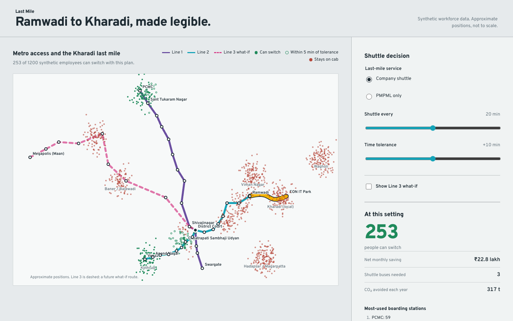

# Last Mile

Should your company run a shuttle from Ramwadi Metro to Kharadi — and who would actually switch from cabs?

A planning tool for transport teams in Pune. Built with Codex for the DevDay Exchange Community Metro Hackathon,
Pune, 24 Oct 2026 — started the morning of the event (with the host's go-ahead) and refined on the moving Metro sprint.
Commit history shows the timeline.

**What it finds (synthetic 1,200-person company at EON IT Park):** the public PMPML feeder fills up at 150 riders;
a company shuttle from Ramwadi every **20 minutes** is the optimum — 253 people off cabs, 3 buses, ₹22.8 lakh/month net,
317 t CO₂/year. More frequent shuttles add riders but cost more than they save. When Line 3 opens end to end: 461 people.

**Run it:** `python3 -m http.server 8000` → open http://localhost:8000. Works offline.
**Test it:** `node --test tests/`

Data: stations and the PMPML feeder route are real (approximate positions). Employees, costs and speeds are synthetic
assumptions, all listed in `data/assumptions.json` and on screen.

- Spec: `PLAN.md` · Agent rules: `AGENTS.md` · Design brief: `docs/design-brief.md` · Demo: `docs/demo-script.md`
